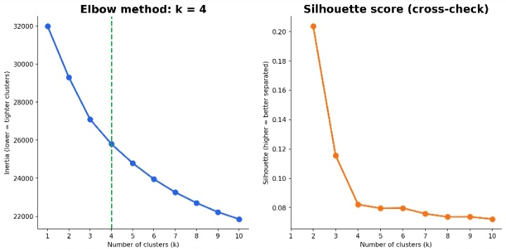
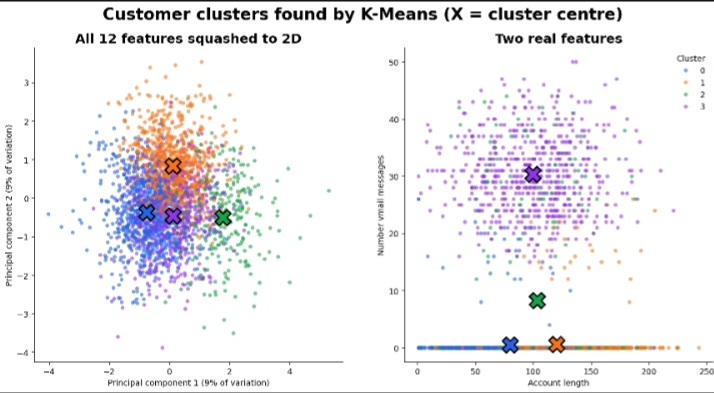
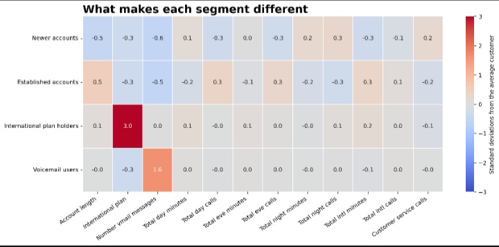
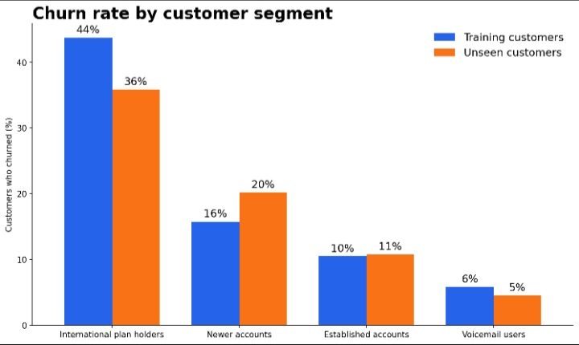

# K-Means Clustering: Customer Segmentation

Codveda Technology Machine Learning Internship · Level 2, Task 3

A reproducible pipeline that groups telecom customers into segments with
K-Means, picks the number of clusters with the elbow method, visualizes the
clusters, and interprets them.

## Dataset

2,666 customers (`churn-bigml-80.csv`) with call-usage data and a `Churn`
label. The label is not used for clustering (K-Means is unsupervised); it is
used only afterwards to interpret the segments. A second file,
`churn-bigml-20.csv` (667 customers), is used only as an optional check on
customers the model never saw.

## Pipeline

| Step | Script | What it does |
|------|--------|--------------|
| 1 | `01_load_and_preprocess.py` | Selects features and standardizes them |
| 2 | `02_find_optimal_k.py` | Elbow method (plus silhouette check), then fits K-Means |
| 3 | `03_visualize_clusters.py` | 2D scatter plots of the clusters |
| 4 | `04_interpret_clusters.py` | Names the segments and compares their churn |

## Key decisions

- **Features (12).** Dropped the 4 "charge" columns because they are exact
  copies of the minutes columns (correlation 1.0) and would count the same
  behaviour twice. Dropped `State` and `Area code` (identifiers) and
  `Voice mail plan` (fully explained by the voicemail message count).
- **Scaling.** All features are standardized, because K-Means works on
  distances and a column in the hundreds (minutes) would otherwise swamp one in
  single digits (service calls).
- **Choosing k.** The elbow method (found in code as the point farthest from
  the line joining the first and last points) suggests k = 4. The curve is
  gentle rather than sharply bent, and the silhouette score is low at k = 4
  (0.082), so the clusters overlap. The silhouette is highest at k = 2 (0.204),
  but that split is essentially "international plan vs not", so k = 4 was
  chosen for more useful segments.





## Visualizing the clusters

Twelve features cannot be drawn directly, so the left chart squashes them to 2D
with PCA (which keeps only about 18% of the variation, so the clusters appear
to overlap). The right chart plots two real features.





## Results: four customer segments

| Segment | Customers | Churn (training) | Churn (unseen customers) |
|---|---|---|---|
| International plan holders | 270 (10%) | 44% | 36% |
| Newer accounts | 889 (33%) | 16% | 20% |
| Established accounts | 907 (34%) | 10% | 11% |
| Voicemail users | 600 (22%) | 6% | 5% |

Overall churn is about 14.6%.

- **International plan holders** churn at about 3x the average: the clear
  retention priority.
- **Voicemail users** are the stickiest segment.
- **Newer accounts** have the shortest account length and make the most
  customer service calls.
- Segments are driven by plan type and account length, not call volume: day,
  evening and night minutes are almost identical across segments.
- The same pattern held when the trained clusters were applied to 667 unseen
  customers.








## Limitations

- Segments show who churns more, not why: association, not cause.
- Clusters overlap (low silhouette score), so they are tendencies, not
  clearly separated groups.
- Only 53 of the unseen customers are international plan holders, so that
  segment's 36% is a noisier estimate.

## Setup and run

```bash
pip install -r requirements.txt
python run_all.py
```

The full pipeline takes about 10 seconds. Generated files go to
`data/processed/` and `artifacts/` (not tracked in Git); tables and metrics go
to `outputs/`.

To run a single step: `python src/02_find_optimal_k.py`
(run from the repository root).

### Run in Google Colab

```python
!git clone https://github.com/nikwesamkelo-max/codveda-ml-task4-kmeans-clustering.git
%cd codveda-ml-task4-kmeans-clustering
!pip install -r requirements.txt
!python run_all.py
```

## Tools

Python, pandas, scikit-learn, matplotlib, seaborn, joblib

## Author

Samkelo · [GitHub](https://github.com/nikwesamkelo-max) ·
[LinkedIn](https://linkedin.com/in/samkelo-nikwe-93226b344)
